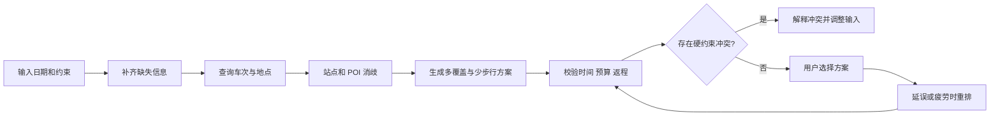

# 产品说明：周末特种兵行程助手

## 产品目标

帮助已经确定目的城市的周末旅行者，在到家时间、每人预算、必去地点和体力限制下比较可行方案，并在延误或疲劳后调整未完成行程。

作品集目标是展示 AI 应用产品工作：问题定义、范围取舍、模型与程序分工、外部工具协作、可解释的约束校验和基于反馈的迭代。

## 首版用户与范围

- 用户：时间有限、愿意接受紧凑行程、但需要明确返程与花费的短途旅行者。
- 已知目的地的两天一夜、单人、直达往返作为实现边界。
- 首轮样例为杭州—上海；出行地址、必去点及偏好由使用者输入，不暗示为真实订单或个人旅程。
- 规划、比较和重排纳入首版；支付、购票、预订、多人协商和未定目的地推荐不纳入。

## 核心任务与结果

用户提供日期、出发地、车站选择、到家时间、预算、必去地点和步行/休息偏好。助手追问缺失的硬约束，查询车次与 POI，给出“多覆盖”与“少步行”两份提案。每份提案说明费用、步行、时间、取舍、来源、查询时间以及仍需核实的信息。延误或体力变化后，重排剩余内容并保留已完成事项。

## 产品规则

- 返程约束是到达用户实际住址的时间；车站到家的接驳未确定时，返程仍需核实。
- 必去地点、预算与最晚到家是硬约束；偏好可讨论调整，但不静默放宽。
- 车票候选先按车站电报码过滤，再按查询乘车日期、出发时刻和历时归一化。
- 同名地点须用 POI ID、区县、类别和地址确认。多个候选未消歧前不安排路线。
- 查得信息、估算和未知分别标记。预约要求不等同于预约成功。
- 方案结构通过校验不代表所有实时信息齐全；输出分别陈述硬错误和待确认项。

## 用户流程

## 首版成功信号

通过同一输入与通用 AI 攻略对比，记录用户完成首次判断所需时间、手工修改次数、硬约束违反数，以及是否理解延误调整的取舍。基线与目标在实际访谈前不预填，以免把期望写成结果。
