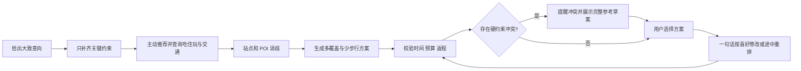

# 产品说明：周末特种兵行程助手

## 产品目标

用户只给大致出行意向，助手主动推荐并安排吃、住、玩、交通和休息，给出能照着走的详细周末计划，再按用户的一句话偏好快捷修改。预算、最晚到家、必去点与体力限制约束整个计划。当前优先做 AI 客户端内的 Skill，使用宿主模型，不要求额外模型 API。

作品集目标是展示 AI 应用产品工作：问题定义、范围取舍、模型与程序分工、外部工具协作、可解释的约束校验和基于反馈的迭代。

## 首版用户与范围

- 用户：时间有限、愿意接受紧凑行程、但需要明确返程与花费的短途旅行者。
- 已知目的地的两天一夜、单人、直达往返作为实现边界。
- 首轮样例为杭州—上海；出行地址、必去点及偏好由使用者输入，不暗示为真实订单或个人旅程。
- 规划、比较和重排纳入首版；支付、购票、预订、多人协商和未定目的地推荐不纳入。

## 核心任务与结果

用户可以只说“周末从杭州去上海，想看看建筑、吃点好的，别太累”。助手提取已有条件，只追问影响可行性的缺口；主动推荐片区、景点、餐饮与住宿参考，并挑选合适车站/有票车次。展开推荐计划，给轻松备选；说明每段为什么这样排、时间/交通/费用、来源与待确认项。用户不需要先有景点清单或理解 MCP。“这个不喜欢”“晚一小时”“想多吃一点”直接修改受影响部分，保留原版及已完成事项。

现有真实网页仍是手动选车次/POI 的数据联调工具；完善 Skill 不代表网页已经具备自由语言推荐。Skill 的实际推荐质量还需对话验收和用户体验验证。

## 产品规则

- 返程约束是到达用户实际住址的时间；车站到家的接驳未确定时，返程仍需核实。
- 核验到家时间只需住处附近地标、地铁站或返程站到家的估计接驳时间，不要求精确住址。目的城市的住宿由助手先推荐；已订住宿才作为固定锚点。
- 必去地点、预算与最晚到家是硬约束；偏好可讨论调整，但不静默放宽。
- 预算用实时交通和可核对的住宿、餐饮、市内交通、门票及接驳逐项衡量；未知费用不能算作零。预算不足时先提醒，仍输出完整参考行程、费用构成和缺口，保留原预算并标为未满足；用户无需先调整预算才能看到行程，不默认采用不睡觉的省钱方式。
- 用户未给预算上限时，先用查询结果展示费用构成与可行区间，再请用户选择；不把 1,000 元样例默认为每趟旅行的预算。
- 车票候选先按车站电报码过滤，再按查询乘车日期、出发时刻和历时归一化。
- 同名地点须用 POI ID、区县、类别和地址确认。多个候选未消歧前不安排路线。
- 查得信息、估算和未知分别标记。预约要求不等同于预约成功。
- 方案结构通过校验不代表所有实时信息齐全；输出分别陈述硬错误和待确认项。

预算及行程密度的用户样本与适用边界见 [特种兵旅行预算与行程样本调研](特种兵旅行预算与行程样本调研-2026-10-16.md)。

## 用户流程

## 首版成功信号

通过同一输入与通用 AI 攻略对比，记录用户完成首次判断所需时间、手工修改次数、硬约束违反数，以及是否理解延误调整的取舍。基线与目标在实际访谈前不预填，以免把期望写成结果。
